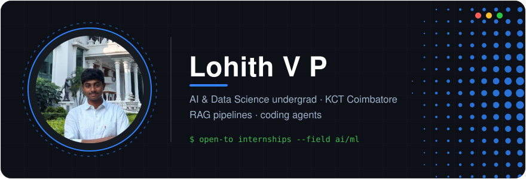

 

&nbsp;<a href="mailto:lohithvp307@gmail.com">Mail</a>&nbsp;&nbsp;·&nbsp;&nbsp;&nbsp;<a href="https://www.linkedin.com/in/lohith-v-p-0990440q">LinkedIn</a>&nbsp;&nbsp;·&nbsp;&nbsp;&nbsp;<a href="https://leetcode.com/u/_lohith_">LeetCode</a>

---

## 👋 About

I'm an AI & Data Science undergrad at Kumaraguru College of Technology, Coimbatore — originally from Karur, Tamil Nadu. I like taking models out of notebooks and putting them behind APIs: retrieval systems that cite their sources, agents that fix their own bugs, and computer vision with real day jobs.

## 🧰 Tech Stack

Also in the toolbox: Hugging Face Transformers · ChromaDB · XGBoost · Sentence Transformers · Grad-CAM · RAG · ReAct agents

## 🚀 Projects I'm Proud Of

| Project | What it does |
|---|---|
| **[LawRAG](https://github.com/lohith889/LawRAG)** | Legal RAG that cites the exact section it answered from · `FastAPI` `ChromaDB` |
| **[codey](https://github.com/lohith889/codey)** | An agent that plans, runs and repairs its own code until tests pass · `Python` |
| **[Fundus-Fusion-AI](https://github.com/lohith889/Fundus-Fusion-AI)** | Retinal image stitching + disease screening · `PyTorch` `OpenCV` |
| **[Next-Word-Predictor](https://github.com/lohith889/Next-Word-Predictor)** | An LSTM that finishes your sentences — my first end-to-end neural net |
| **HeatViz** | Mapped urban heat across 18,040 micro-blocks of a city |

## 🏆 Wins

- **AI for Impact Award** — Hack for Impact 2026, GDG on Campus KCT
- **Winner** — Nilgiris Impact Challenge 2026

## 📊 The Numbers

&nbsp;&nbsp;

---

**கற்றது கைமண் அளவு · கல்லாதது உலகளவு**

What I've learned fits in a handful of sand · what I haven't would fill the world

